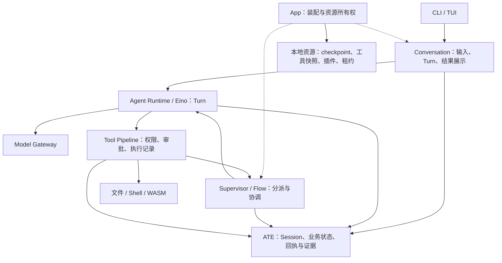

# 架构导读

GSEA 是一个本地优先的编程 Agent 宿主。它接收用户请求，组织模型和工具完成工作；需要时把工作交给子 Agent，在验收后交付结果，并保留中断后判断“已经做了什么、下一步能做什么”的依据。自进化体现在有证据的经验复用、工具发布与执行策略调整，具体执行仍受宿主的权限、预算和工作区边界约束。

核心分工是：**ATE 保存权威业务事实，GSEA 宿主作出执行与协调决策，本地资源支撑实际运行。** Eino 提供单个回合的模型—工具循环；它不拥有 Team 调度、Task 验收或业务持久化的最终解释权。

本文依据当前生产装配和源码说明职责与边界，不是测试验收报告。按工作流定位实现见 [代码阅读指南](CODE_READING_GUIDE.md)。统一执行领域位于 `internal/execution`，运行资源包为 `internal/runtimestore`，宿主对 ATE 的读取与决策状态端口为 `internal/ateports`。

## 从一个请求看系统如何工作

以“修改一个功能并验证结果”为例：

1. **接收与装配。** CLI/TUI 把输入交给 Conversation。App 打开本地运行资源、连接 ATE、核对 authority 身份，取得 Session 的执行所有权，关联 root Agent、Thread 和 Team。只读控制入口使用另一条装配路径，不启动执行服务。
2. **确定本次执行条件。** Conversation 准备历史与上下文；Factory 选择执行策略，固定工具快照并保留引用，然后构造 Turn。`turn.started` 与开场输入作为同一批 Session 事件提交后，才继续准入回调和 Eino 执行。
3. **模型提出行动，宿主执行。** 模型请求经过 `modelgateway`；工具调用经过 `tool.Pipeline` 的身份、参数、权限、审批与执行记录边界，再进入文件工具、Shell、WASM 插件或编排工具。流式文字是展示信号，不能代替持久结果。
4. **按需要扩大工作范围。** 普通对话可以直接完成一个 Turn。需要验收、预算、截止时间或协作的工作绑定 `ExecutionContract`，由 Task、Execution 和 Step 保存执行身份；复杂工作可由 Supervisor 分派给子 Agent，Flow 提供可复用的组合控制流程。
5. **分别完成执行、验收和交付。** `turn.completed` 表示该回合执行完成，不自动意味着 Task 验收通过或修改已合入主工作区。Supervisor 保存工作结果回执后再做协调结算；隔离工作区的产物还要经过候选冻结、合并和相应验证。
6. **中断后按原身份恢复。** 宿主先核对未完成的 ATE 请求，再读取 Session、Task、Execution、Agent 和资源状态。恢复可能是继续执行、重放已完成结果或补做结算；不能一律转换为新的用户输入或重跑工具。

图中的实线表示主要调用或读写关系；ATE 访问在实现上经过仓库接口和适配器。App 的虚线表示装配关系。

## 概念与身份

这些概念分别回答“在哪段历史里、为谁、为哪个目标、执行哪一次工作”，不构成一条所有对象都必须遵循的嵌套树。

| 概念              | 用途与归属                                                             | 与其他概念的关系                                                                             |
| ----------------- | ---------------------------------------------------------------------- | -------------------------------------------------------------------------------------------- |
| Session           | 一条有序、持久的交互与执行历史，由 `session.EventStore` 访问           | 包含多个 Turn；root 和子 Agent 各有自己的 Session。历史不是当前模型上下文的同义词            |
| Turn              | 一次固定工具快照的 Eino 循环，可能包含多次模型请求和工具调用           | 属于一个 Session；恢复沿用原 Turn ID。一个执行可以包含多个 Turn                              |
| ExecutionContract | 宿主固定的目标、范围、约束、验收、时限和预算                           | 由 `internal/execution` 计算 canonical hash，并由 Task/Execution/Step 绑定到 Turn            |
| 执行领域          | 独立拥有 Contract、Binding、生命周期、验证、交付和恢复收据             | `internal/execution` 不依赖 Eino、ATE adapter 或具体持久化；其他模块通过适配字段接入         |
| 编排 Task         | Team 内可依赖、认领、分派、验收和交付的工作单元                        | 由 `orchestration.TaskSnapshot` 表达；可有父任务、依赖和不同 Agent 尝试                      |
| Agent             | 具有持久身份、父子关系、配置和状态的执行参与者                         | 归属 Team，绑定 Thread/Session，可关联 Task；可经历多个 Run                                  |
| Team              | root Agent 及其协作成员的生命周期和资源管理范围                        | 与 root Session 关联；重新打开 Session 可以重新激活已结束的 Team                             |
| Thread            | 编排域中对话所有者与上下文关系的身份                                   | 通过记录关联 Agent 与 Session；不是操作系统线程，也不是另一份聊天历史                        |
| Agent Run         | 一次被宿主接纳的 Agent 执行身份，关联等待、结果和结算                  | `CurrentRunID` 随恢复或等待续行保留；正常的新执行可以产生新 Run。Run ID 与 Turn ID 不可互换  |
| Flow              | 宿主定义的流式组合流程及其持久运行、步骤状态                           | `agentflow.Run` 固定定义 revision/fingerprint、输入和工具快照；Flow 的 Run/Step 属于自己的域 |
| Agent profile     | 不可变的执行配置：指令、模型别名、工具集合、委派能力、工作区模式和限额 | 子 Agent 保存 profile snapshot；恢复不把今天的默认配置覆盖到原执行                           |
| 工具快照          | 本次执行可见的工具定义及实现身份清单                                   | Turn/Flow 固定内容地址；进程内 registry generation 仅用于诊断。它不包含整个工作区文件内容    |

一个典型关系是：root Session 对应 root Agent/Thread 和一个 Team；该 Team 有多个编排 Task 与子 Agent；某个子 Agent 的 Run 通过它自己的 Conversation 执行 Turn，必要时由 Execution/Step 记录多次尝试和恢复。Flow 可以组织这些动作，但不是每个请求的必经层。

### ATE 的 Task / Execution / Step 是另一层协议

ATE 的 `agent/v1` profile 是宿主无关的状态机协议。它的 Task 表达目标及 goal/cancel epoch，Execution 表达 actor 的一次执行身份与 incarnation，Step 表达执行中的序号、输入锚点和状态。这里的 **profile 指持久化协议**，与 GSEA 的 Agent 配置 profile 不同。

| 名称                        | 当前 GSEA 使用方式                                                                                                          | 不能据此推导                                                   |
| --------------------------- | --------------------------------------------------------------------------------------------------------------------------- | -------------------------------------------------------------- |
| ATE Task / Execution / Step | 经验链路的 `atebridge.EnsureExecution` 为 Turn 建立记录用途的 Task、Execution 和一个 Step，供知识作用域、证据和终态记录使用 | ATE 正在替宿主调度 Task DAG，或每次模型调用都对应一个 ATE Step |
| GSEA 编排 Task              | 由 native 编排仓库把 Task、依赖、claim、事件等写入 ATE state records                                                        | 该记录就是 ATE `agentprofile.Task`，或二者状态枚举可以直接互换 |
| GSEA ExecutionContract      | 由 Task/Execution/Step 绑定 Turn，验收与交付由 Supervisor、verification 和 workspace coordinator 协作完成                   | ATE Task 的 `Goal` 字段等同于 GSEA 的完整执行契约              |
| Agent Run / Flow Run        | 分别由 Supervisor 和 Flow runtime 管理                                                                                      | 它们天然等于 ATE Execution，或 Go goroutine 的寿命             |

当前桥接的创建动作本身不调度模型或工具。宿主仍决定是否执行、何时验收、如何重试和何时停止。

## 所有权与依赖方向

| 所有者                               | 负责什么                                                           | 边界                                                                                                                      |
| ------------------------------------ | ------------------------------------------------------------------ | ------------------------------------------------------------------------------------------------------------------------- |
| `app`                                | 配置解析后的依赖装配、authority 绑定、执行租约、服务生命周期与关闭 | 生产环境的数据库、WASM、工具管线和执行服务由这里接线；领域服务不反向依赖 App                                              |
| `conversation`                       | 输入串行化、上下文准备、Turn 结果展示、恢复阶段选择                | Conversation 同时只运行一个回合；Task 完成不能仅由助手最终文字判定                                                        |
| `agentruntime` / `modelgateway`      | 固定配置构造 Eino Turn、记录模型请求与响应、用量、上下文管理和回放 | Eino ADK 构造集中在 runtime；模型供应商适配集中在 gateway                                                                 |
| `agentmanager` / `agentflow`         | Agent 调度、等待、邮箱、Task 派发与结算；组合流程的控制算子        | 持久状态经仓库读写，调度选择由宿主作出；Flow 的工具和编排副作用经过 Pipeline                                              |
| `tool` / `policy` / `approval`       | 工具版本解析、参数校验、可信 ActorScope、权限与审批、结果记录      | 模型工具参数不能自行赋予 Team/Agent 身份或扩大 profile 权限                                                               |
| native 仓库                          | Session 事件适配、编排状态变更、业务回执、索引与一致性校验         | `session/atestore` 使用 ATE 原生 Session；`orchestration/atestore` 与 `evolutionstore` 经 `ateauthority` 写 state records |
| `ateprocess` / `aterequest`          | ATE 进程与连接租借、准确请求身份、结果核对                         | 生产宿主使用 ATE client/API，不把 ATE engine 嵌入业务执行层                                                               |
| `workspacecoord` / `workspacedomain` | 候选与合并协议；实际文件访问的租约和进程存活协调                   | 工作区字节和外部命令不处于 ATE 事务内                                                                                     |
| `experience` / 插件与策略服务        | 证据驱动的经验选择和维护、构建验证与发布、策略候选和回退           | runtime 通过 `experienceport` 访问经验能力；持久决策与本地产物分开归属                                                    |

领域类型和接口向内稳定，适配器实现接口，App 在外部组合它们。具体依赖约束可读 [architecture_test.go](internal/architecture/architecture_test.go)；该文件说明约束，不构成本文执行过测试的证明。

### ATE 权威与本地资源各保存什么

“唯一业务事实源”约束的是业务历史和状态的解释权，不表示所有文件、锁和缓存都必须存入 ATE。

| 数据                                                                                    | 当前位置与作用                                                                             |
| --------------------------------------------------------------------------------------- | ------------------------------------------------------------------------------------------ |
| Session / SessionEvent                                                                  | ATE 原生记录；保存对话、模型与工具执行边界，支持原生分页、关联读取和历史截点               |
| Team、Agent、Thread 关联、编排 Task、Flow、mailbox、预算/用量、工作区协调业务状态和回执 | ATE state records；由宿主仓库定义业务约束，并把相关状态与编排事件放入相应 batch            |
| 经验、知识选择及维护状态、策略和插件构建/验证业务记录                                   | ATE；模型选择和宿主校验形成可追溯决策，历史证据仍来自明确的权威来源                        |
| Eino checkpoint、工具快照 manifest/引用、插件 blob/revision、LSP projection             | 本地 runtime 数据库；用于恢复实际执行环境或提供运行反馈                                    |
| 未决 ATE 请求及已接收拒绝的处理信息                                                     | 本地 `ATERequests()`；保存原始请求字节、身份和尝试状态，供核对使用，不镜像已提交业务历史   |
| artifact、snapshot/worktree 文件、Shell/WASM/LSP 进程                                   | 本地资源；存在不代表 Task 已完成，丢失也不能通过改写业务事实掩盖                           |
| 工作区租约与进程存活信息                                                                | `workspacedomain` 的共享协调数据库与锁；协调同一工作区的运行实例，不充当 Session/Task 仓库 |

`OpenRuntime` 只打开当前运行资源格式，会拒绝旧业务数据库或混合格式；它不隐式执行历史业务迁移。共享 ATE 的可见性也不等于执行权：宿主按 ATE StoreID 与 Session ID 取得执行租约，Supervisor 的恢复、claim 回收和预算预留处理限制在所拥有的 Team。

## 三种事件与三层完成边界

### 事件不是一份通用日志的三个别名

| 层次                            | 回答的问题                                               | 读者与顺序                                                                                   |
| ------------------------------- | -------------------------------------------------------- | -------------------------------------------------------------------------------------------- |
| SessionEvent                    | 这个 Session 的 Turn 看到了什么、请求了什么、执行到哪里  | Conversation、runtime、工具回放与历史查询；使用 Session sequence、correlation 和 snapshot ID |
| orchestration event             | 哪个 Team/Agent/Task/mailbox/Flow 发生了什么业务变化     | Supervisor、业务查询和展示；使用 stream sequence 及仓库维护的 global sequence                |
| ATE 物理 journal / commit fence | 哪个存储提交已耐久、在哪个锚点读取、请求回执对应哪个提交 | ATE 存储与协议层；物理 LSN/fence 不能当作 Session 或编排流的业务序号                         |

`agentruntime/turn_journal.go` 是从 Session 事件重建模型输入与响应的回放逻辑。工作区 apply journal 则记录文件应用的进度。二者都不能因名字中有 journal 就被当作 ATE 物理日志，也不能由“日志存在”推断外部副作用成功。

### 请求回执、业务回执、运行资源收尾

| 层次                      | 能证明什么                                                                   | 后续仍可能需要什么                                                                             |
| ------------------------- | ---------------------------------------------------------------------------- | ---------------------------------------------------------------------------------------------- |
| ATE 请求回执              | 经身份、digest 和 fence 校验的 `durable_ack` 证明**该准确命令**已提交        | 完成其余业务步骤；删除本地 pending 记录也可能独立失败                                          |
| 业务回执                  | Agent completion、merge finalization、retention receipt 等描述领域结果或阶段 | 检查 prepared/dispatched/completed/settled 等本领域状态；不能把任意一条 receipt 视为全流程完成 |
| runtime closure / cleanup | 本地 checkpoint、工具快照引用等执行资源已按业务授权完成关闭或释放            | 它不改写业务结果、不删除历史证据，也不撤销文件或外部命令的效果                                 |

例如 retention 先保存业务关闭计划与准入墓碑，再写 Session 审计事件，最后标记 native receipt 完成；只有成功完成该协议后才允许本地资源清理。本地释放失败可以按原计划重试，不能把未释放资源误判为业务仍开放。

### 原子性止于实际提交边界

`ateauthority.Update` 在固定 ATE view 上读取，形成带根 CAS 的一个有界 state batch；状态、索引和事件是否原子取决于是否由同一 callback 写入。只有明确拒绝的前置条件冲突才允许重新计算 callback；callback 因此不能执行模型、Shell 或其他外部副作用。

下列操作必须按多个提交理解：

- **Execution 与 Session。** `turn.started` 和开场输入是一批 Session 事件；Task/Execution/Step、契约绑定和 verification 走业务仓库的独立提交。执行绑定、Turn/Execution 身份和恢复逻辑负责衔接这些窗口；它们不构成跨存储的大事务。
- **`turn.failed` 与 strategy fallback。** `Turn.fail` 先尝试追加失败及相关 Session 事件，再通过单独调用记录策略回退；没有共同事务，两者可以独立失败。回退影响后续策略选择，不自动重跑失败回合。
- **快照引用与业务准入。** Turn/Flow 先保留工具快照，再写业务执行记录；中断可能留下额外引用。不能反过来把本地引用当作该执行已开始的证据。
- **工作结果与协调结算。** Supervisor 先冻结 Agent completion receipt，再交付候选、更新 Task 和处理依赖。结算失败保留待处理回执，不应改写原工作结果或重新执行 worker。
- **文件应用与业务状态。** 合并使用 apply plan/journal、前后内容校验和 finalization 协议；文件系统和 ATE 没有跨介质事务。外部验证已 dispatch 而结果未知时，恢复不能擅自再次执行验证命令。

`session/atestore.Append` 也有自己的边界：一次逻辑事件批次保持原子；大 payload 可先发布不可变引用，再提交事件批次。`AnySequence` 在该实现中仍捕获当前序号并提交 CAS，不是在冲突后不断追逐最新 head 的承诺。

## 执行与恢复中的几个关键机制

**工具调用。** Pipeline 按 Session/Turn/Call ID 查找已有结果，再执行参数与权限检查。已经有耐久成功结果时返回原结果；存在 `tool.started` 却没有确定副作用结果时，走 outcome unknown 边界。缺少成功记录不证明工具未执行。领域失败只有被耐久记录后才能作为普通工具错误交回模型；基础设施或持久化失败需要终止当前执行路径。

**配置与上下文。** profile 约束实际执行权限，工具快照固定实现版本。快照身份覆盖工具描述、schema、ImplementationID 和宿主可执行文件身份；动态执行器的配置仍须由 revision/ImplementationID 表达。上下文压缩、工具结果外置和历史选择改变模型本次看到的视图，不改写原始 Session 历史。上下文窗口预算与 Team 累计消费预算分别管理。

**Task verification。** 候选正文可以先冻结，阶段事件仍可展示执行与验收进度。Verifier 对支持的条件使用真实工具取证；只覆盖部分条件不能证明整体契约达标。验证基础设施失败不是新一轮工具执行，恢复应先判断已有候选和 verification receipt。

**多 Agent 与工作区。** Supervisor 以运行槽、模型 bucket 和 Team 状态控制准入；邮箱和 WaitSet 保存消息与等待关系。Task 完成可能受 reviewer gate 或 `awaiting_merge` 阶段约束，子 Agent 返回成功并不立即解锁所有依赖。只读或隔离工作区子 Agent 可并行；当前同一 Supervisor 内共享可写工作区的子 Agent 串行执行，单次操作租约不等于整项工作的隔离。

**经验与自进化。** `Prepare` 选择上下文，模型 dispatch 前 `Check` 校验可用性，Turn 事实落地后 `Complete` 处理经验维护。插件构建、验证、发布与策略候选评估由宿主服务协调；新发布影响后续执行，已开始的 Turn 使用原快照。经验维护待重试与主执行的结果分别记录，不能用维护成功替代任务验收。

**恢复与关闭。** 只读发现不创建 Runner、不调用模型；“有 checkpoint”只是一项发现结果，真正 resume 还要验证快照、模型/profile、准入和墓碑。普通启动先核对已知 ACK；Session 请求计划须在取得对应执行租约后按原依赖顺序恢复。App 关闭先停止并等待自己拥有的工作，再释放资源；worker 不响应取消而超时，会保留资源与所有权直到进程退出。

## 当前限制与名称待定项

| 边界           | 当前限制及其影响                                                                                                                                                              |
| -------------- | ----------------------------------------------------------------------------------------------------------------------------------------------------------------------------- |
| 未知请求结果   | ATE 尚无耐久拒绝回执协议；已尝试请求在查询时不存在，不能区分“未到达”与“拒绝响应丢失”。保留原 envelope 并报告 unknown，不自动换 ID 或重新提交                                  |
| 外部副作用     | 文件、Shell、供应商模型请求与 ATE 不共享事务；不能宣称端到端 exactly-once。恢复需要确定回执或显式未知状态                                                                     |
| 有界提交与读取 | Session append、payload、state batch 和分页都有容量边界；超过原子批次限制会报错，不通过拆批伪造原子性                                                                         |
| 恢复环境       | 缺失插件产物、快照不兼容或宿主二进制变化可能阻止恢复；保留业务历史不保证本地执行资源总能重建                                                                                  |
| 用量与费用     | 预留和恢复估算用于保守准入与记账，不等于供应商账单；token 估算及缺失价格信息不提供严格费用上限                                                                                |
| 调度与隔离     | Task DAG 已有依赖、claim、分派、验收和重指派路径；关键路径优先级未实现。共享可写子 Agent 串行；跨实例文件协调依赖 workspace domain，rendezvous 不可用时需关注其 degraded 状态 |
| 模型配置       | runtime 有显式模型解析接口；当前 CLI 内置 profile 使用 chat 模型，不等于已提供用户侧多模型目录                                                                                |

本文使用已核对的当前名称：

- `internal/runtimestore`：App 通过 `OpenRuntime` 打开运行资源，只含 checkpoint、插件/LSP/快照引用与未完成 ATE 请求；`Compact` 仅回收空闲页，不做保留期决策。
- `internal/ateports`：宿主对 ATE 的端口，只定义精确历史读取和语义决策状态，不承担投递、镜像或第二份业务历史。
- `internal/atebridge`：承接 ATE 执行语义与经验请求，经 `ateports` 读写，不保存历史副本。

旧的 `internal/session/sqlitestore`、`internal/temporaljournal` 名称与旧业务适配器均已删除；不要把历史文档中的旧路径当作现行架构。
